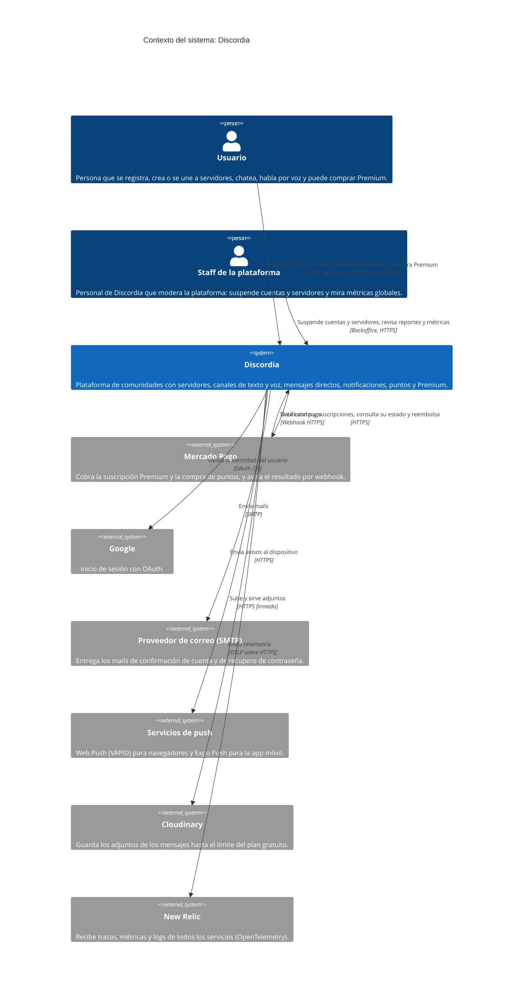

# C4 nivel 1: contexto del sistema

Muestra Discordia como una caja negra: quién la usa y con qué sistemas de terceros habla. No muestra tecnologías ni servicios internos (eso está en el [nivel 2](02-contenedores.md)).

## Quién interactúa

| Actor | Qué hace con el sistema |
|---|---|
| Usuario | Es quien usa la aplicación web o la móvil. Un mismo usuario puede ser dueño de un servidor, moderador o miembro común, según los roles y permisos que tenga en cada servidor. |
| Staff de la plataforma | Entra por el backoffice, que es un cliente aparte. Los permisos de staff son de plataforma, no de un servidor. |

## Sistemas externos

| Sistema | Para qué lo usamos | Cómo se integra |
|---|---|---|
| Mercado Pago | Cobrar Premium y puntos | `billing` crea el cobro o la suscripción y recibe el webhook en una ruta pública del gateway, que no exige JWT porque Mercado Pago no lo manda. |
| Google | Iniciar sesión | `identify-service` valida el código de OAuth. |
| Proveedor de correo | Confirmar la cuenta y recuperar la contraseña | `identify-service` envía por SMTP. |
| Servicios de push | Avisar de menciones y mensajes con la app cerrada | `notifications` envía a los navegadores (Web Push con claves VAPID) y a los celulares (Expo Push). |
| Cloudinary | Adjuntos chicos de mensajes | `messaging` sube con una firma y la URL queda en el mensaje. Los adjuntos grandes (Premium) van a Supabase Storage, que es parte del sistema (ver nivel 2). |
| New Relic | Observabilidad | Los ocho servicios exportan por OpenTelemetry. |

Las bases de datos (Supabase y MongoDB Atlas) y la mensajería (RabbitMQ) son parte del sistema, no sistemas externos de otro dueño: aparecen en el [nivel 2](02-contenedores.md).
