# C4 nivel 2: contenedores

Abre la caja de Discordia: las aplicaciones y los almacenes de datos que la componen, con su tecnología y cómo se hablan. Un "contenedor" acá es algo que se despliega y corre por separado (no es un contenedor de Docker, aunque casi todos lo sean).

El detalle interno de `messaging` está en el [nivel 3](03-componentes-messaging.md).

```mermaid
C4Container
    title Contenedores de Discordia

    Person(usuario, "Usuario", "Usa Discordia desde el navegador o el celular.")
    Person(staff, "Staff", "Administra la plataforma.")

    System_Boundary(clientes, "Clientes") {
        Container(web, "web-client", "Next.js, React (Vercel)", "Aplicación web.")
        Container(mobile, "app-mobile", "Expo, React Native", "Aplicación móvil.")
        Container(backoffice, "backoffice", "Next.js (Vercel)", "Panel del staff.")
    }

    Container(gateway, "gateway", "Kong DB-less y Caddy", "Único punto de entrada: valida el JWT, aplica rate limiting y enruta.")

    System_Boundary(backend, "Servicios") {
        Container(identify, "identify-service", "Go, Gin", "Registro, login, sesiones, 2FA, OAuth, perfil.")
        Container(servers, "servers", "Go, Gin", "Servidores, canales, roles y permisos, invitaciones, moderación, boosts.")
        Container(messaging, "messaging", "Elixir, Phoenix", "Mensajes, mensajes directos, menciones, reacciones, adjuntos, presencia y tiempo real.")
        Container(notifications, "notifications", "Elixir, Phoenix (Render)", "No leídos, centro de notificaciones, push y avisos de cambio en tiempo real.")
        Container(billing, "billing", "Go, Gin", "Puntos, Premium, boosts y cobros.")
        Container(admin, "admin", "Go, Gin", "API del backoffice: suspensiones, listados, expediente.")
        Container(metrics, "metrics", "Go, Gin (Render)", "Métricas de actividad de servidores y globales.")
        Container(signaling, "voice-sfu: signaling", "Elixir, Phoenix (Fly.io)", "Autoriza las salas de voz y emite los tokens.")
        Container(livekit, "LiveKit", "Go (Fly.io)", "Servidor de medios (SFU) para el audio.")
    }

    ContainerQueue(rabbit, "RabbitMQ", "AMQP", "Exchange discordia.events (topic) y messaging.broadcast (fanout). Cada consumidor tiene su cola y su DLQ.")

    System_Boundary(supabase, "Supabase") {
        ContainerDb(pg_identify, "Postgres: identify", "PostgreSQL", "Usuarios y sesiones; outbox de eventos.")
        ContainerDb(pg_servers, "Postgres: servers", "PostgreSQL", "Servidores, canales, roles, invitaciones, moderación.")
        ContainerDb(pg_messaging, "Postgres: messaging", "PostgreSQL", "Outbox de eventos.")
        ContainerDb(pg_voice, "Postgres: voice", "PostgreSQL", "Sesiones de voz.")
        ContainerDb(pg_admin, "Postgres: admin", "PostgreSQL", "Réplica de usuarios y servidores, staff, expediente.")
        ContainerDb(storage, "Storage", "Supabase Storage", "Avatares, íconos y banners, y adjuntos grandes de Premium.")
    }

    System_Boundary(atlas, "MongoDB Atlas") {
        ContainerDb(mongo_messaging, "Mongo: messaging", "MongoDB", "Mensajes, conversaciones, bloqueos, menciones, réplica de permisos.")
        ContainerDb(mongo_notifications, "Mongo: notifications", "MongoDB", "Actividad por canal, marcadores de lectura, historial, dispositivos push.")
    }

    ContainerDb(pg_billing, "Postgres: billing", "PostgreSQL", "Cuentas de puntos, suscripciones, outbox.")
    ContainerDb(pg_metrics, "Postgres: metrics", "PostgreSQL", "Proyección de eventos para las métricas.")

    System_Ext(mercadopago, "Mercado Pago", "Cobros")
    System_Ext(cloudinary, "Cloudinary", "Adjuntos chicos")
    System_Ext(correo, "Proveedor de correo", "SMTP")
    System_Ext(push, "Servicios de push", "Web Push y Expo")

    Rel(usuario, web, "Usa", "HTTPS")
    Rel(usuario, mobile, "Usa")
    Rel(staff, backoffice, "Usa", "HTTPS")

    Rel(web, gateway, "Pide datos", "HTTPS, JSON")
    Rel(mobile, gateway, "Pide datos", "HTTPS, JSON")
    Rel(backoffice, gateway, "Pide datos", "HTTPS, JSON")
    Rel(web, gateway, "Mensajes y avisos en vivo", "WebSocket con ticket de un solo uso")
    Rel(mobile, livekit, "Audio", "WebRTC")
    Rel(web, livekit, "Audio", "WebRTC")

    Rel(gateway, identify, "Enruta /v1/auth y perfil", "HTTP")
    Rel(gateway, servers, "Enruta /v1/servers", "HTTP")
    Rel(gateway, messaging, "Enruta mensajes", "HTTP y WebSocket")
    Rel(gateway, notifications, "Enruta /v1/notifications", "HTTPS y WebSocket")
    Rel(gateway, billing, "Enruta puntos y Premium; webhook de Mercado Pago", "HTTP")
    Rel(gateway, admin, "Enruta /v1/admin", "HTTP")
    Rel(gateway, metrics, "Enruta métricas", "HTTPS")
    Rel(gateway, signaling, "Enruta /api/voice", "HTTPS")

    Rel(signaling, livekit, "Crea salas y emite tokens", "API de LiveKit")
    Rel(signaling, servers, "Consulta membresía y permisos", "HTTP")
    Rel(signaling, messaging, "Consulta el acceso al canal de voz", "HTTP")

    BiRel(identify, rabbit, "Publica y consume eventos", "AMQP")
    BiRel(servers, rabbit, "Publica y consume eventos", "AMQP")
    BiRel(messaging, rabbit, "Publica y consume eventos", "AMQP")
    BiRel(billing, rabbit, "Publica y consume eventos", "AMQP")
    BiRel(admin, rabbit, "Publica y consume eventos", "AMQP")
    BiRel(signaling, rabbit, "Consume eventos", "AMQP")
    Rel(rabbit, notifications, "Entrega eventos", "AMQP")
    Rel(rabbit, metrics, "Entrega eventos", "AMQP")

    Rel(identify, pg_identify, "Lee y escribe", "SQL")
    Rel(identify, storage, "Sube avatares", "HTTPS")
    Rel(servers, pg_servers, "Lee y escribe", "SQL")
    Rel(servers, storage, "Sube íconos y banners", "HTTPS")
    Rel(messaging, pg_messaging, "Outbox, antes de escribir en Mongo", "SQL")
    Rel(messaging, mongo_messaging, "Lee y escribe", "MongoDB")
    Rel(notifications, mongo_notifications, "Lee y escribe", "MongoDB")
    Rel(billing, pg_billing, "Lee y escribe", "SQL")
    Rel(admin, pg_admin, "Lee y escribe", "SQL")
    Rel(metrics, pg_metrics, "Lee y escribe", "SQL")
    Rel(signaling, pg_voice, "Lee y escribe", "SQL")

    Rel(messaging, cloudinary, "Sube adjuntos chicos", "HTTPS firmado")
    Rel(messaging, storage, "Sube adjuntos grandes (Premium)", "HTTPS")
    Rel(billing, mercadopago, "Cobros y suscripciones", "HTTPS")
    Rel(identify, correo, "Mails de cuenta", "SMTP")
    Rel(notifications, push, "Envía avisos", "HTTPS")
```

## Cómo se comunican

- **Síncrono (REST):** los clientes hablan solo con el gateway. Entre servicios solo hay llamadas síncronas desde `voice-sfu`, y solo al emitir un token de voz: le pregunta a `servers` por la membresía y los permisos, y a `messaging` por el acceso al canal.
- **Asíncrono (eventos):** todo lo demás se propaga por RabbitMQ, en el exchange `discordia.events`. Cada servicio publica sus cambios y los demás mantienen una réplica local de lo que necesitan, sin consultar al dueño. Los eventos firmados con HMAC (`admin.*`, `billing.*`, boosts) no se pueden falsificar desde otro servicio.
- **Tiempo real:** `messaging` y `notifications` abren WebSockets que pasan por el gateway. `notifications` además empuja avisos sin datos (`changed`) para que los clientes vuelvan a pedir lo que cambió.

## Los contenedores

| Contenedor | Responsabilidad | Tecnología | Datos que guarda | Dónde corre |
|---|---|---|---|---|
| web-client | Aplicación web | Next.js, React | — | Vercel |
| app-mobile | Aplicación móvil | Expo, React Native | — | Expo; el servidor de desarrollo corre en una VM de Oracle |
| backoffice | Panel del staff | Next.js | — | Vercel |
| gateway | Entrada única, JWT, rate limiting | Kong DB-less, Caddy | — (config en un YAML) | VM de Oracle |
| identify-service | Identidad | Go | Postgres de identify, Storage | VM de Google Cloud |
| servers | Servidores, canales, roles | Go | Postgres de servers, Storage | VM de Google Cloud |
| messaging | Mensajes y presencia | Elixir | Mongo de messaging, outbox en Postgres; adjuntos en Cloudinary (chicos) y en Supabase Storage (grandes, Premium) | VM de Oracle |
| notifications | No leídos, push, avisos | Elixir | Mongo de notifications | Render |
| billing | Puntos y Premium | Go | Postgres de billing | VM de Oracle |
| admin | Backoffice (API) | Go | Postgres de admin | VM de Oracle |
| metrics | Métricas | Go | Postgres de metrics | Render |
| voice-sfu (signaling) | Salas de voz | Elixir | Postgres de voice | Fly.io |
| LiveKit | Audio | Go | — | Fly.io |
| RabbitMQ | Bus de eventos | RabbitMQ | colas y DLQ | VM de Oracle |

## Decisiones que se ven en el diagrama

- **Una base por servicio.** Ningún servicio lee la base de otro; lo que necesita de otro lo replica por eventos (ADR 0003, réplica local de permisos en `messaging`, y ADR 0007, no leídos por eventos en `notifications`).
- **Outbox transaccional** en `identify-service`, `servers`, `billing`, `admin` y `messaging`: el evento se guarda en la misma transacción que el cambio y un proceso aparte lo publica (ADR 0004).
- **Reintentos con espera creciente y DLQ** en todos los consumidores ([reintentos-y-dlq](../reintentos-y-dlq.md)).
- **Dos lenguajes y dos tipos de base:** Go y Elixir; PostgreSQL y MongoDB, según lo que mejor le sirve a cada servicio.
