# C4 nivel 3: componentes de `messaging`

Abre un contenedor del [nivel 2](02-contenedores.md): `messaging` (Elixir, Phoenix). Es el servicio más grande y el que reúne los tres mecanismos más importantes de la arquitectura: tiempo real por WebSocket, outbox con publicación a RabbitMQ y réplica local de datos de otros servicios.

Un "componente" es un grupo de módulos con una responsabilidad. Cada uno corresponde a una carpeta de `lib/` del repo `messaging`.

```mermaid
C4Component
    title Componentes de messaging

    Container(gateway, "gateway", "Kong", "Valida el JWT y enruta.")
    ContainerQueue(rabbit, "RabbitMQ", "AMQP", "discordia.events y messaging.broadcast.")
    ContainerDb(mongo, "Mongo: messaging", "MongoDB", "Mensajes, conversaciones, bloqueos, menciones, réplica de permisos.")
    ContainerDb(pg, "Postgres: messaging", "PostgreSQL", "Tabla del outbox.")
    System_Ext(cloudinary, "Cloudinary", "Adjuntos chicos")
    ContainerDb(supabase, "Supabase Storage", "Storage", "Adjuntos grandes (Premium)")
    Container(notifications, "notifications", "Elixir", "Recibe los eventos de mensajes.")

    Container_Boundary(messaging, "messaging") {
        Component(rest, "API REST", "Phoenix controllers y plugs", "Mensajes, conversaciones, bloqueos, menciones, emojis, búsqueda, adjuntos y presencia. El plug Authenticate toma el usuario del JWT que Kong ya validó y rechaza las cuentas suspendidas.")
        Component(sockets, "Tiempo real", "Phoenix Channels", "Salas de canal, canal personal del usuario y presencia. Se entra con un ticket de un solo uso.")
        Component(tickets, "Tickets", "Messaging.Auth", "Emite y consume tickets de WebSocket y de subida de adjuntos (de un solo uso, 30 s).")
        Component(chat, "Dominio del chat", "Messaging.Chat", "Reglas de mensajes, menciones, reacciones, bloqueos, filtro de palabras, búsqueda y adjuntos.")
        Component(access, "Autorización", "Messaging.Chat.Access y Permissions", "Decide si un usuario puede ver o escribir en un canal, usando la réplica local de roles y overrides.")
        Component(repo, "Repositorio", "Messaging.Chat.Repo", "Acceso a MongoDB: mensajes, réplica de permisos y de usuarios, índices.")
        Component(storage, "Almacenamiento de adjuntos", "Messaging.Storage.Tiered", "Elige el destino según el tamaño y el plan: Cloudinary o Supabase Storage.")
        Component(presence, "Presencia", "Messaging.Presence", "Seguimiento del estado en línea, barrido de sesiones vencidas y aviso a los contactos.")
        Component(outbox, "Outbox", "Messaging.Outbox", "Anota cada evento en Postgres antes de escribir en Mongo; un poller completa la escritura si falta y publica en RabbitMQ.")
        Component(publishers, "Publicación", "Messaging.Events", "Publica por el outbox los eventos message_created, direct_message_created y demás, y difunde a las salas.")
        Component(consumers, "Consumidores de eventos", "Messaging.Events", "Consumen servers.*, users.*, boosts y emojis; mantienen la réplica local y cierran el acceso cuando se borra un canal o servidor.")
        Component(signed, "Consumidores firmados", "Messaging.Suspension y Premium", "Verifican la firma HMAC de los eventos admin.* y billing.* antes de aplicarlos.")
        Component(broadcast, "Difusión entre instancias", "Messaging.Events (fanout)", "Pasa por RabbitMQ lo que ocurre en una instancia para que las demás lo lleven a sus WebSockets.")
    }

    Rel(gateway, rest, "Enruta", "HTTP")
    Rel(gateway, sockets, "Enruta", "WebSocket")
    Rel(rest, tickets, "Emite tickets")
    Rel(sockets, tickets, "Consume el ticket")
    Rel(rest, chat, "Usa")
    Rel(sockets, chat, "Usa")
    Rel(rest, presence, "Consulta el estado")
    Rel(sockets, presence, "Registra la conexión")
    Rel(chat, access, "Pregunta si puede")
    Rel(chat, repo, "Lee y escribe")
    Rel(access, repo, "Lee la réplica de permisos")
    Rel(repo, mongo, "Lee y escribe", "MongoDB")
    Rel(chat, storage, "Guarda adjuntos")
    Rel(storage, cloudinary, "Sube", "HTTPS firmado")
    Rel(storage, supabase, "Sube", "HTTPS")
    Rel(chat, outbox, "Anota el evento antes de escribir")
    Rel(outbox, pg, "Escribe y relee", "SQL")
    Rel(outbox, repo, "Completa la escritura en Mongo si falta")
    Rel(outbox, publishers, "Entrega al despachar")
    Rel(publishers, rabbit, "Publica", "AMQP")
    Rel(publishers, sockets, "Difunde a la sala", "Phoenix.PubSub")
    Rel(publishers, broadcast, "Avisa a las otras instancias")
    Rel(broadcast, rabbit, "Publica y consume", "AMQP")
    Rel(rabbit, consumers, "Entrega servers.*, users.*", "AMQP")
    Rel(rabbit, signed, "Entrega admin.* y billing.*", "AMQP")
    Rel(consumers, repo, "Actualiza la réplica")
    Rel(signed, chat, "Bloquea o habilita")
    Rel(rabbit, notifications, "Entrega mensajes", "AMQP")
```

## Qué hace cada componente

| Componente | Carpeta en `lib/` | Responsabilidad |
|---|---|---|
| API REST | `messaging_web/controllers`, `messaging_web/plugs` | Un controlador por recurso. No tiene lógica de negocio: delega en el dominio. La firma del JWT la valida Kong; el servicio solo extrae el usuario y comprueba que no esté suspendido. |
| Tiempo real | `messaging_web/channels` | `room_channel` (un canal de texto), `user_channel` (avisos personales: mensajes directos y menciones) y `presence_channel`. |
| Tickets | `messaging/auth` | Los WebSockets no llevan el JWT en la URL: se pide un ticket de un solo uso por REST y se canjea al conectar. Está guardado en Mongo, con un almacén reemplazable. |
| Dominio del chat | `messaging/chat` | Mensajes, edición y borrado, reacciones, menciones, bloqueos entre usuarios, filtro de palabras, emojis propios, búsqueda y limpieza de adjuntos huérfanos. |
| Autorización | `messaging/chat/access`, `permissions` | Resuelve permisos sin llamar a `servers`, con la réplica local (ADR 0003): `VIEW_CHANNELS` para leer y `SEND_MESSAGES` para escribir. |
| Repositorio | `messaging/chat/repo`, `chat/replica` | Única puerta a MongoDB, para poder cambiar el almacenamiento sin tocar el dominio. |
| Almacenamiento de adjuntos | `messaging/storage` | `Tiered` manda a Cloudinary hasta el límite gratuito y a Supabase Storage lo más grande (solo Premium). |
| Presencia | `messaging/presence` | `Tracker` registra conexiones, `Sweeper` vence las que dejaron de responder y `Notifier` avisa el cambio de estado. |
| Outbox | `messaging/outbox` | Se anota el evento en Postgres **antes** de tocar Mongo. Cada fila lleva el evento y la instrucción para dejar Mongo en el estado correcto, así que si la instancia muere o Mongo falla, `Poller` y `Dispatcher` completan la escritura y publican (ADR 0004). Si RabbitMQ se cae, el evento espera en Postgres y no se pierde. |
| Publicación | `messaging/events` | Eventos de mensajes y de actividad que consumen `notifications` y `admin`. |
| Consumidores de eventos | `messaging/events` | Cola `messaging.channel_lifecycle` (canales, roles, miembros, dueño, borrado de servidor), `messaging.server_emojis` y boosts. Con reintentos con espera creciente y DLQ. |
| Consumidores firmados | `messaging/suspension`, `premium`, `events` | Rechazan un `admin.*` o `billing.*` cuya firma HMAC no coincide. |
| Difusión entre instancias | `messaging/events` (`broadcast_*`) | Hace posible tener más de una instancia: lo que ocurre en una llega a los sockets de las otras (ADR 0006). |

## Por qué está dividido así

- **El dominio no sabe de HTTP ni de WebSocket.** Los controladores y los canales son delgados y llaman al mismo dominio, por eso REST y tiempo real aplican las mismas reglas de permisos.
- **El repositorio y el almacenamiento son puertos** (comportamientos con implementaciones intercambiables): en los tests se reemplazan con dobles sin tocar `lib/`.
- **El outbox va primero.** Como el mensaje vive en Mongo y el evento en RabbitMQ no se pueden confirmar a la vez, el evento se anota antes en Postgres y todo lo demás (escribir en Mongo, publicar) es reintentable e idempotente. Un mensaje aceptado nunca queda sin avisar.
- **La autorización es local.** Chequear un permiso es una lectura en Mongo, sin red; por eso `messaging` sigue respondiendo si `servers` está caído.
