# Guía de usuario de la app de Discordia

Esta guía cuenta cómo usar Discordia desde el celular: crear la cuenta, entrar a servidores, chatear, hablar por voz y, si administrás un servidor, cómo configurarlo y moderarlo.

Las capturas son de un Android con el tema oscuro. En iPhone la app se ve igual; lo único que cambia son los permisos del sistema.

## Contenido

1. [Instalar la app](#1-instalar-la-app)
2. [Crear una cuenta e iniciar sesión](#2-crear-una-cuenta-e-iniciar-sesión)
3. [La pantalla principal](#3-la-pantalla-principal)
4. [Servidores](#4-servidores)
5. [Chatear en un canal](#5-chatear-en-un-canal)
6. [Mensajes directos](#6-mensajes-directos)
7. [Canales de voz](#7-canales-de-voz)
8. [Miembros y perfiles](#8-miembros-y-perfiles)
9. [Tu perfil](#9-tu-perfil)
10. [Notificaciones](#10-notificaciones)
11. [Administrar un servidor](#11-administrar-un-servidor)
12. [Configuración de tu cuenta](#12-configuración-de-tu-cuenta)
13. [Premium, puntos y boosts](#13-premium-puntos-y-boosts)
14. [Problemas comunes](#14-problemas-comunes)

## 1. Instalar la app

Hay dos maneras de tener Discordia en el celular:

- **APK de Android.** Es la app completa. Bajás el archivo, lo abrís y Android te va a pedir permiso para instalar apps de fuera de Play Store. Es la única versión que recibe notificaciones push y permite compartir pantalla en una llamada.
- **Expo Go.** Sirve para probar la app sin instalar nada propio. Abrís Expo Go, escaneás el código QR que te pasen y la app se carga adentro. Funciona todo menos las notificaciones push y compartir pantalla.

## 2. Crear una cuenta e iniciar sesión

### Crear una cuenta

<table>
  <tr>
    <td>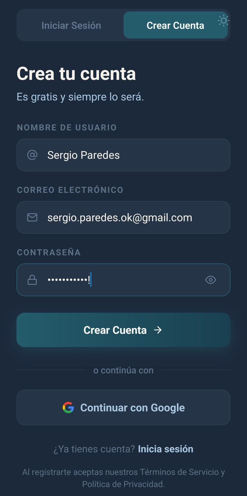</td>
    <td>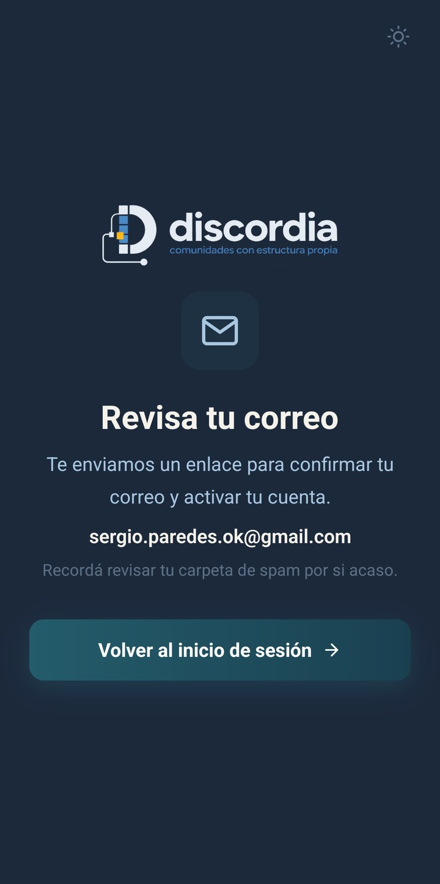</td>
  </tr>
</table>

1. Abrí la app y tocá la pestaña **Crear Cuenta**.
2. Completá los tres campos:
   - **Nombre de usuario**: el nombre que van a ver los demás. Lo podés cambiar después.
   - **Correo electrónico**: tiene que ser uno al que tengas acceso, porque te vamos a mandar un mail.
   - **Contraseña**: con el ojito de la derecha podés ver lo que escribiste.
3. Tocá **Crear Cuenta**. La app te avisa que te mandó un mail a la dirección que pusiste.
4. Abrí el mail de Discordia y tocá el enlace para confirmar el correo. Si no lo ves, buscalo en spam o promociones.

<!-- Captura del mail de confirmación (desde prod) -->

5. Listo: volvé a la app, tocá **Volver al inicio de sesión** y entrá con tu correo y tu contraseña.

Hasta que no confirmes el correo, la app no te deja entrar. Si el enlace venció cuando lo abrís, la app te muestra el botón **Reenviar confirmación** para pedir uno nuevo.

Si preferís no crear una contraseña, tocá **Continuar con Google** y elegí tu cuenta de Google. En ese caso el correo ya queda confirmado.

### Iniciar sesión

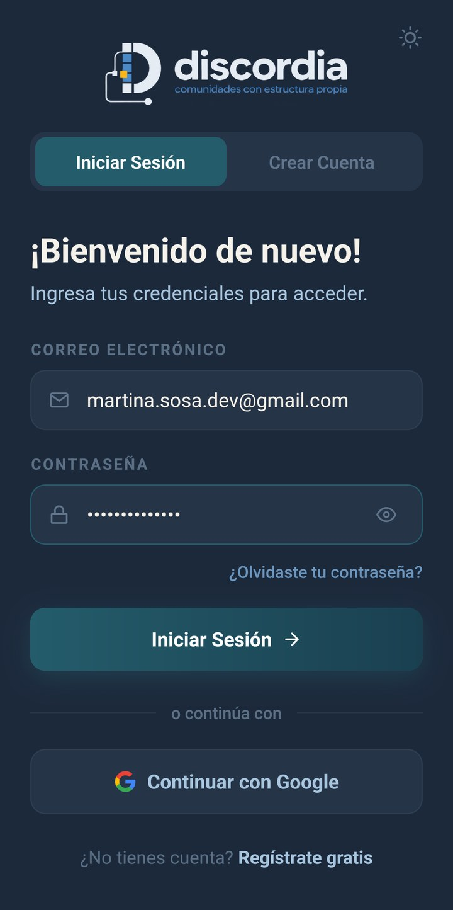

1. En la pestaña **Iniciar Sesión**, escribí tu correo y tu contraseña.
2. Tocá **Iniciar Sesión**.
3. Si tenés activada la [verificación en dos pasos](#verificación-en-dos-pasos), la app te pide el código de seis números de tu app autenticadora. Escribilo y confirmá. Si perdiste el celular con la app autenticadora, podés usar uno de tus códigos de recuperación.

La sesión queda guardada en el celular: la próxima vez que abras la app, entrás directo.

### Recuperar la contraseña

<table>
  <tr>
    <td>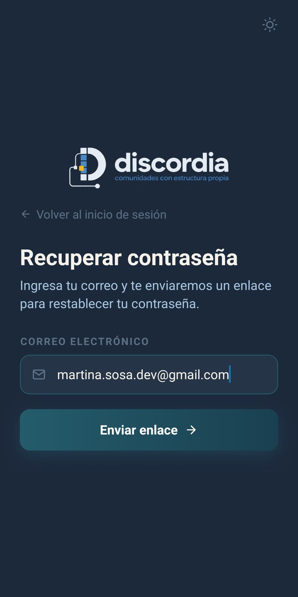</td>
    <td>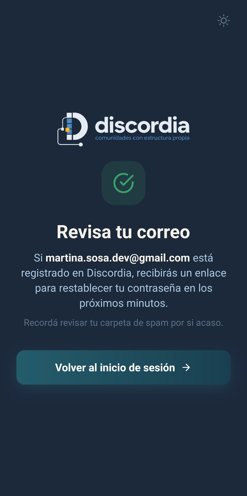</td>
  </tr>
</table>

1. En la pantalla de inicio de sesión, tocá **¿Olvidaste tu contraseña?**.
2. Escribí el correo de tu cuenta y tocá **Enviar enlace**.
3. Te llega un mail con un enlace. Tocalo y elegí la contraseña nueva.
4. Volvé a la app y entrá con la contraseña nueva.

Por seguridad, la app siempre dice que mandó el mail, aunque el correo no tenga una cuenta. Si no te llega, fijate que lo hayas escrito bien.

### Entrar con PIN

Si [configuraste un PIN](#pin-de-acceso-rápido) en este celular, cuando cerrás sesión la app ya no te pide el correo y la contraseña:

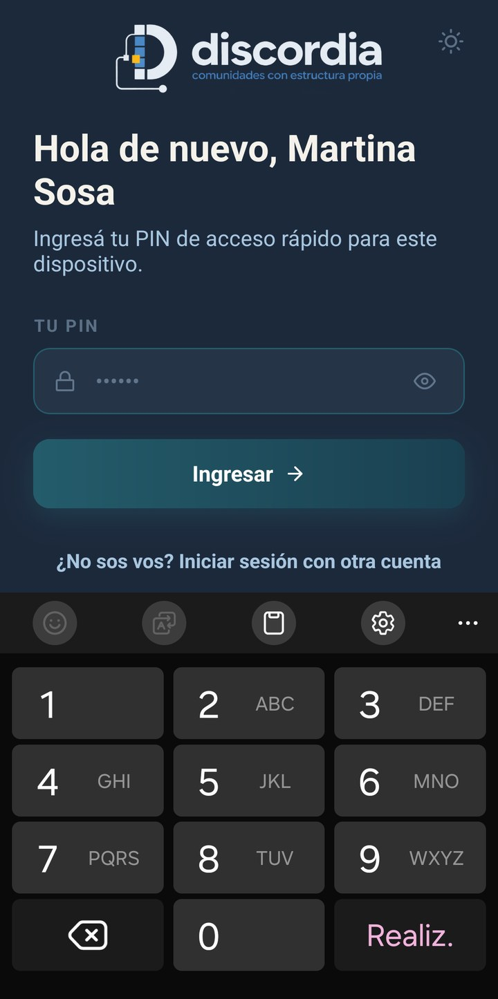

1. La app te saluda por tu nombre y te pide el PIN.
2. Escribilo y tocá **Ingresar**.

Si le errás varias veces seguidas, el PIN se bloquea un rato y tenés que entrar con el correo y la contraseña. Para entrar con otra cuenta, tocá **¿No sos vos? Iniciar sesión con otra cuenta**. El PIN solo sirve en el celular donde lo creaste.

### Cerrar sesión

1. Tocá el engranaje de la barra de abajo.
2. Bajá hasta el final y tocá **Cerrar sesión**.
3. Confirmá con **Cerrar sesión**.

<table>
  <tr>
    <td>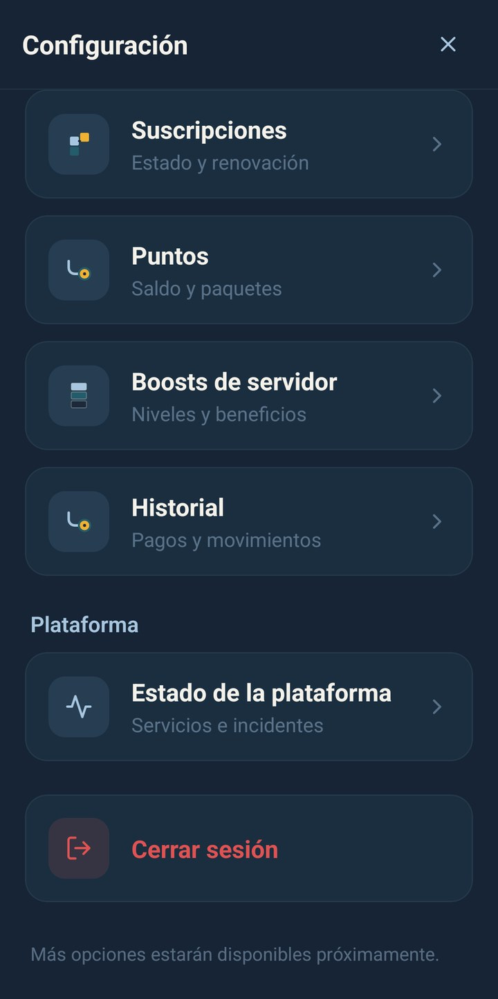</td>
    <td>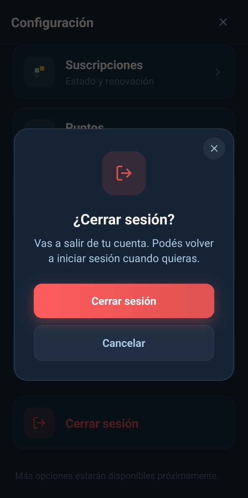</td>
  </tr>
</table>

## 3. La pantalla principal

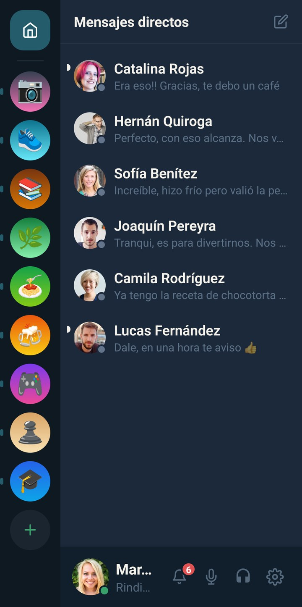

La pantalla tiene tres partes:

- **La barra de la izquierda** muestra tus servidores, cada uno con su ícono. El botón de arriba, el de la casita, te lleva a tus mensajes directos. El **+** de abajo sirve para crear un servidor o sumarte a uno.
- **La parte central** cambia según dónde estés: en la casita ves tus conversaciones privadas, y en un servidor, sus canales.
- **La barra de abajo** es tu panel: tu foto y tu estado, la campanita de notificaciones, los botones para silenciar el micrófono y el audio, y el engranaje de configuración.

Cuando un servidor o un canal tiene mensajes que no leíste, aparece un puntito blanco a su izquierda. Los números rojos son menciones o mensajes directos sin leer.

## 4. Servidores

Un servidor es una comunidad: el grupo de la facultad, el de los amigos, el de una actividad que compartís con otros. Adentro se organiza en categorías y canales.

<table>
  <tr>
    <td>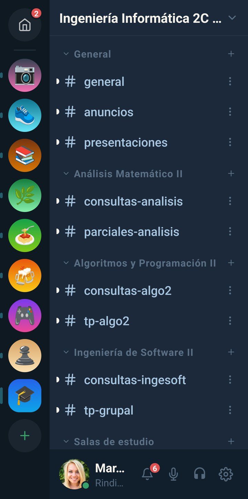</td>
    <td>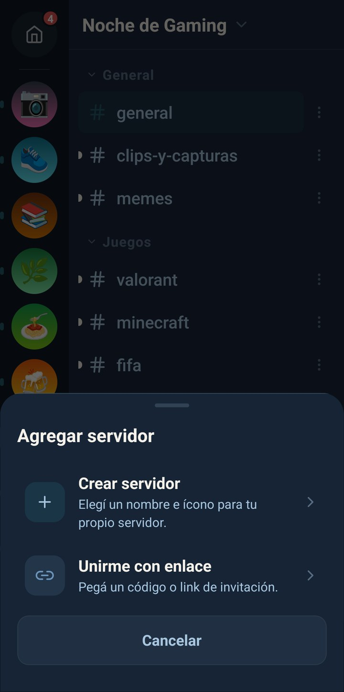</td>
  </tr>
</table>

**Entrar a un servidor.** Tocá su ícono en la barra de la izquierda. Vas a ver los canales agrupados por categoría; las categorías se pliegan y despliegan tocando su nombre.

**Crear un servidor o sumarte a uno.** Tocá el **+** de la barra de la izquierda:

- **Crear servidor**: le ponés un nombre y, si querés, un ícono (PNG, JPEG o WEBP de hasta 5 MB). Vas a ser el dueño y empieza con un canal de texto y uno de voz.
- **Unirme con enlace**: pegás el link o el código de invitación que te pasaron.

<table>
  <tr>
    <td>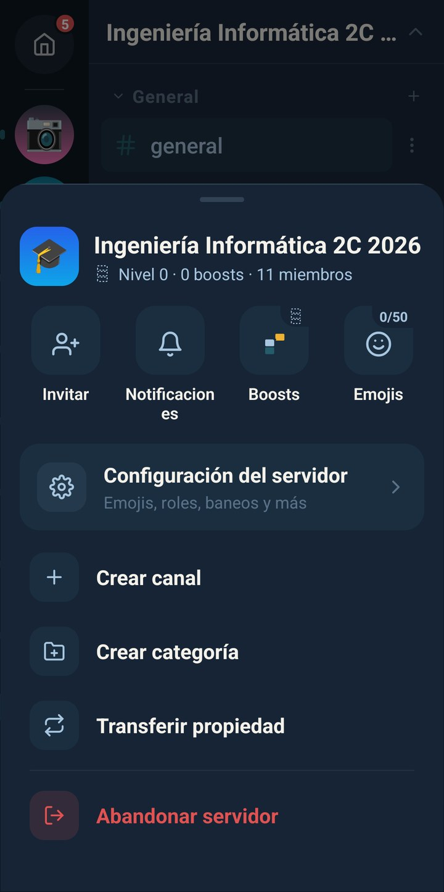</td>
    <td>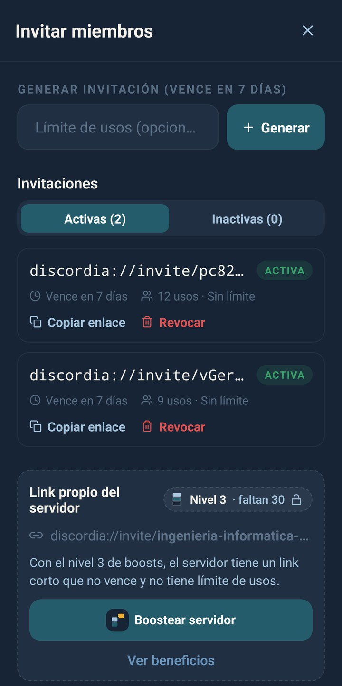</td>
  </tr>
</table>

**El menú del servidor.** Tocá el nombre del servidor, arriba de todo. Desde ahí podés invitar gente, cambiar las notificaciones del servidor, ver los boosts y los emojis, y, si tenés permisos, entrar a la configuración, crear canales y categorías o transferir la propiedad. Al final está **Abandonar servidor**.

**Invitar a alguien.** En **Invitar** generás un enlace que dura 7 días. Si querés, le ponés un límite de usos: por ejemplo, 1 si es para una sola persona. Copiás el enlace y se lo pasás por donde quieras. Desde la misma pantalla podés revocar las invitaciones que ya no quieras que funcionen. Cuando el servidor llega al nivel 3 de boosts, tiene además un link propio que no vence.

## 5. Chatear en un canal

<table>
  <tr>
    <td>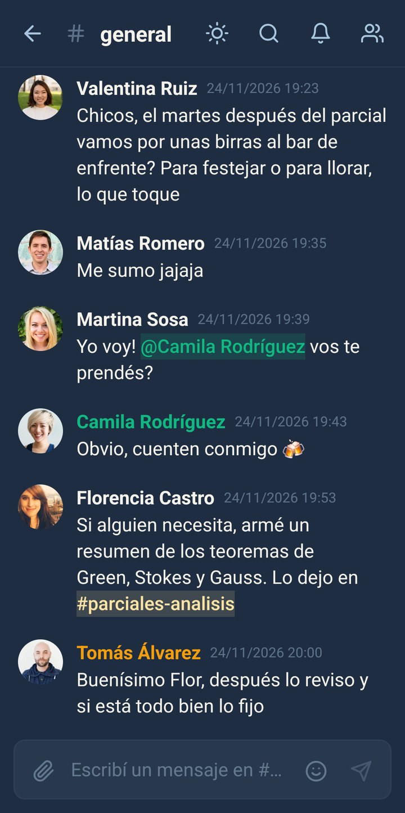</td>
    <td>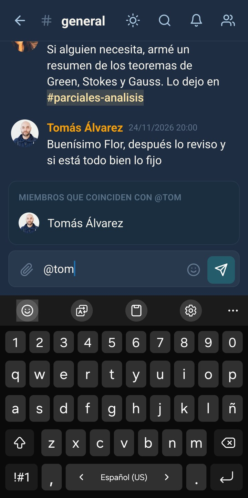</td>
  </tr>
</table>

Tocá un canal con **#** para abrirlo. Los mensajes más nuevos quedan abajo; para ver los anteriores, deslizá hacia arriba.

**Escribir.** Usá el cuadro de abajo y tocá la flecha para mandar. Con el clip adjuntás archivos (hasta 10 MB cada uno, o 50 MB si tenés Premium) y con la carita agregás emojis.

**Darle formato al texto.** Los mensajes aceptan símbolos al estilo Markdown: `**negrita**`, `*cursiva*`, `~~tachado~~`, `||spoiler||`, listas, citas, títulos y bloques de código, entre otros. En la app los símbolos se ven mientras escribís y el formato aparece cuando mandás el mensaje.

<table>
  <tr>
    <td>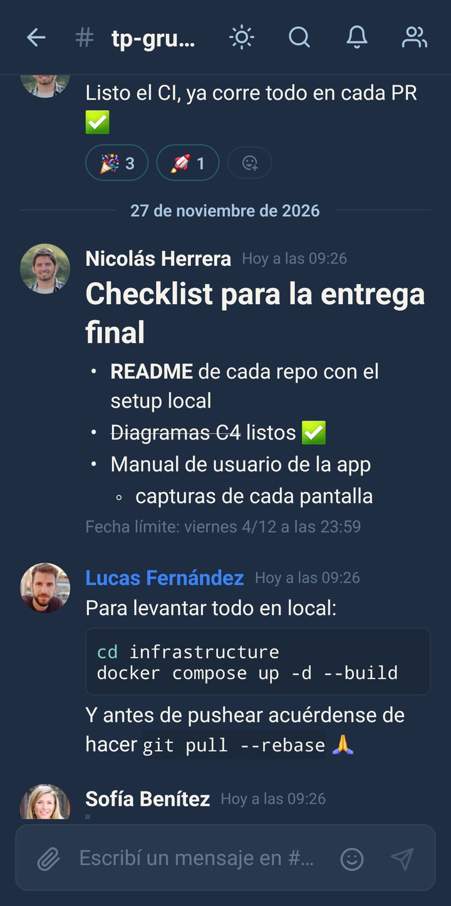</td>
    <td>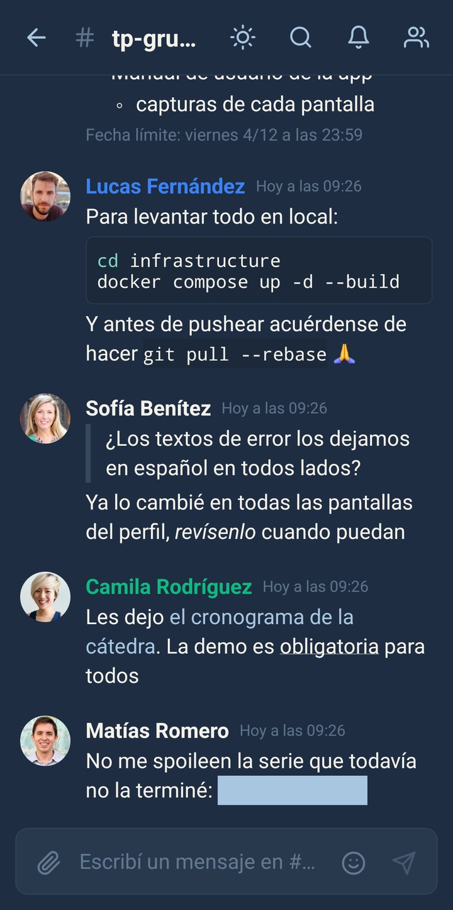</td>
  </tr>
</table>

Todos los formatos, con ejemplos, están en [Formato de mensajes](formato-de-mensajes.md).

**Mencionar a alguien.** Escribí **@** y las primeras letras del nombre: la app te muestra los miembros que coinciden y elegís uno. La persona mencionada recibe un aviso aunque tenga el canal silenciado. Si escribís **#** y el nombre de un canal, queda como un link a ese canal.

<table>
  <tr>
    <td>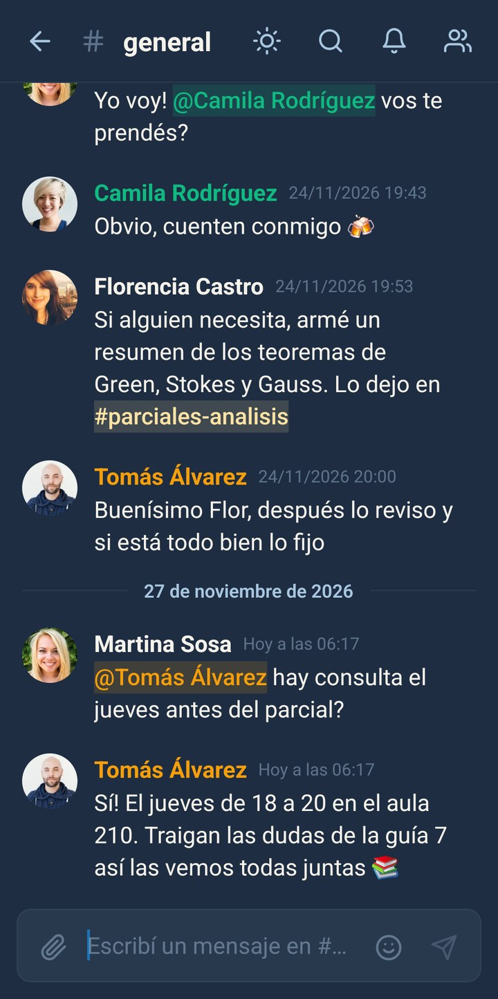</td>
    <td>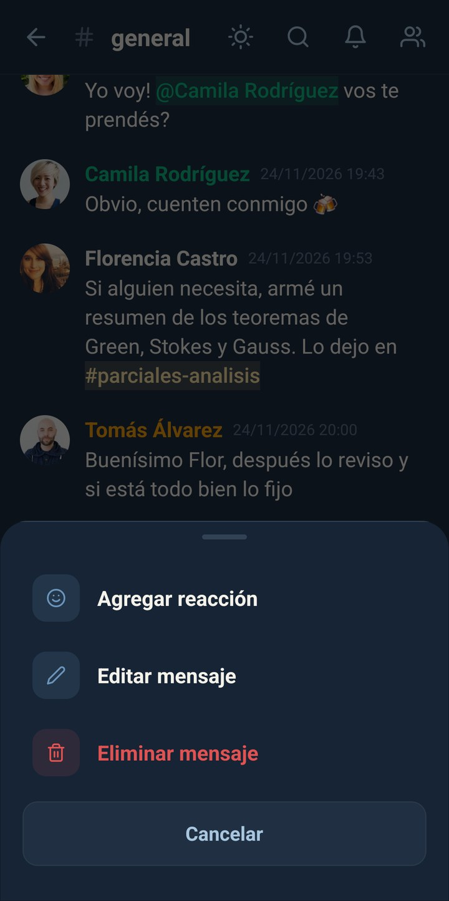</td>
  </tr>
</table>

**Editar, borrar o reaccionar.** Mantené apretado un mensaje para ver sus opciones. En los tuyos podés editarlos o eliminarlos; en los de los demás podés reaccionar o reportarlos. Si sos moderador, también podés borrar mensajes de otros.

<table>
  <tr>
    <td>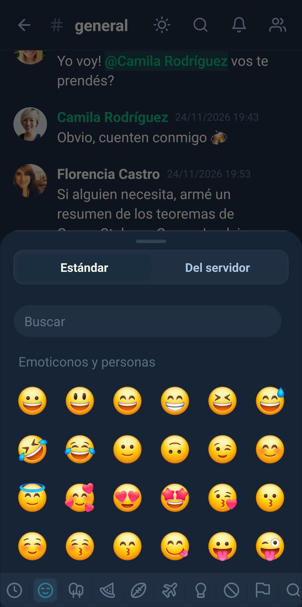</td>
    <td>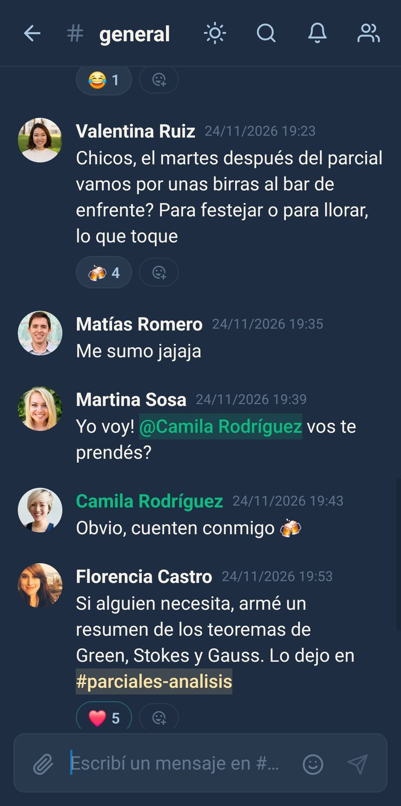</td>
  </tr>
</table>

**Reacciones.** Elegí **Agregar reacción** y buscá el emoji, por categoría o escribiendo su nombre. En la pestaña **Del servidor** están los emojis propios de esa comunidad. Las reacciones aparecen debajo del mensaje con la cantidad de personas que las usaron; la tuya se ve resaltada. Si la tocás de nuevo, la sacás.

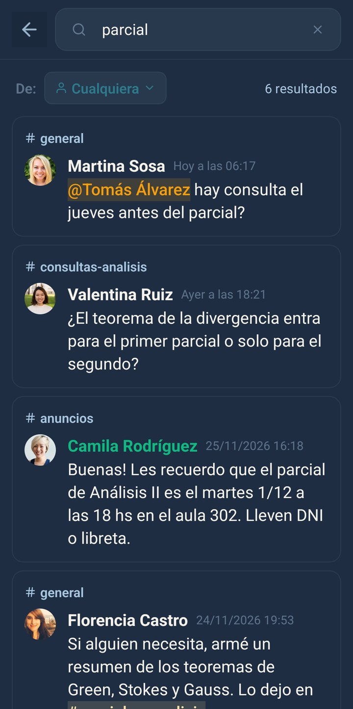

**Buscar mensajes.** La lupa de arriba busca en todos los canales del servidor que podés ver. Con **De:** filtrás por autor. Al tocar un resultado, la app te lleva al mensaje dentro del canal.

**Cambiar de tema.** El sol (o la luna) de arriba cambia entre el tema oscuro y el claro en el momento.

## 6. Mensajes directos

<table>
  <tr>
    <td>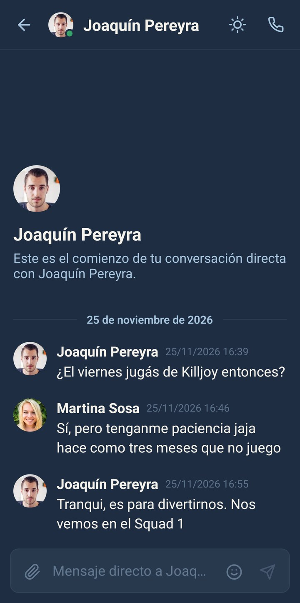</td>
    <td>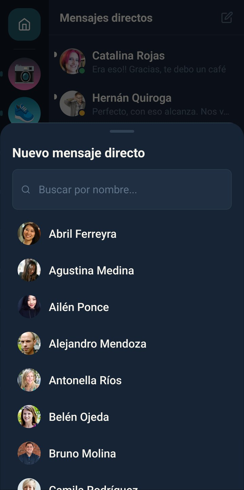</td>
  </tr>
</table>

Los mensajes directos son conversaciones de a dos, fuera de cualquier servidor. Las ves tocando la casita de la barra de la izquierda.

**Empezar una conversación.** Tocá el lápiz de arriba a la derecha y elegí a la persona; podés buscarla por nombre. También podés tocar **Enviar mensaje** en el perfil de alguien.

### Llamadas privadas

<table>
  <tr>
    <td>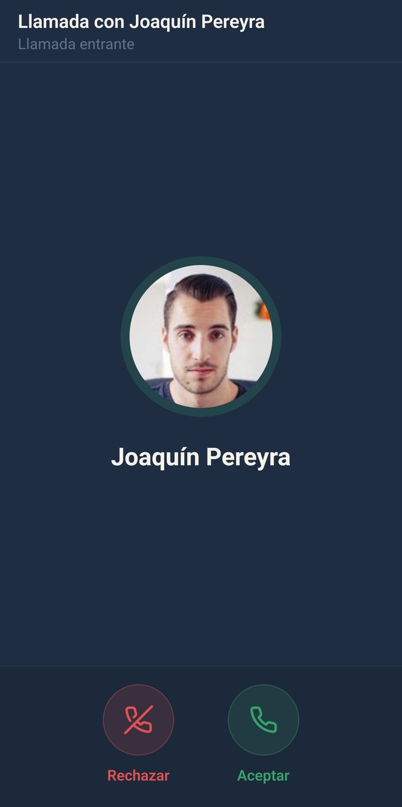</td>
    <td>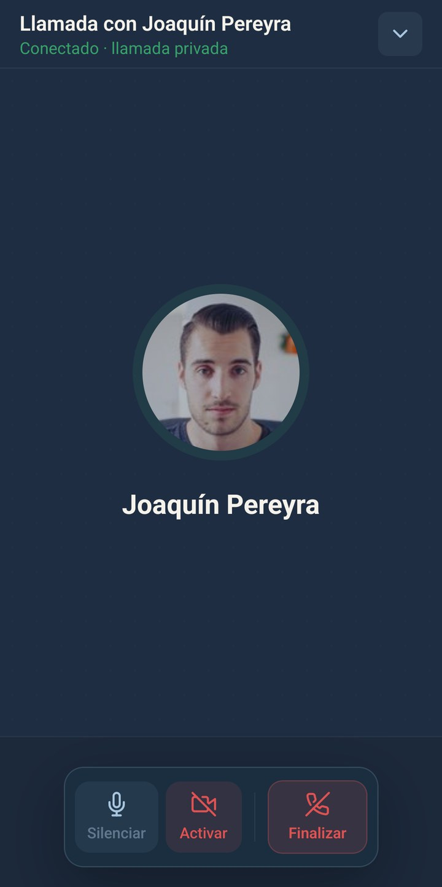</td>
  </tr>
</table>

**Para llamar a alguien:**

1. Abrí la conversación con esa persona.
2. Tocá el teléfono de arriba a la derecha.
3. La app espera a que la otra persona atienda. Si no atiende o rechaza, la llamada se corta sola.

**Cuando te llaman**, aparece una pantalla con la foto y el nombre de quien llama, aunque estés en otra parte de la app:

- **Aceptar** atiende la llamada. La primera vez, el celular te pide permiso para usar el micrófono.
- **Rechazar** corta sin atender.

**Durante la llamada** tenés los mismos botones que en un canal de voz: **Silenciar** el micrófono, **Activar** la cámara y **Finalizar**. Con la flecha de arriba a la derecha minimizás la llamada y seguís usando la app; para volver, tocá el cartel de la llamada.

Si alguien te molesta, podés bloquearlo desde su perfil: deja de poder escribirte por privado.

## 7. Canales de voz

<table>
  <tr>
    <td>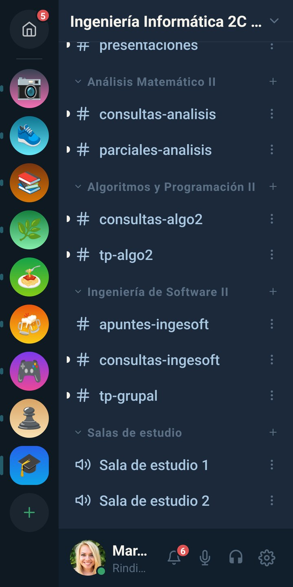</td>
    <td>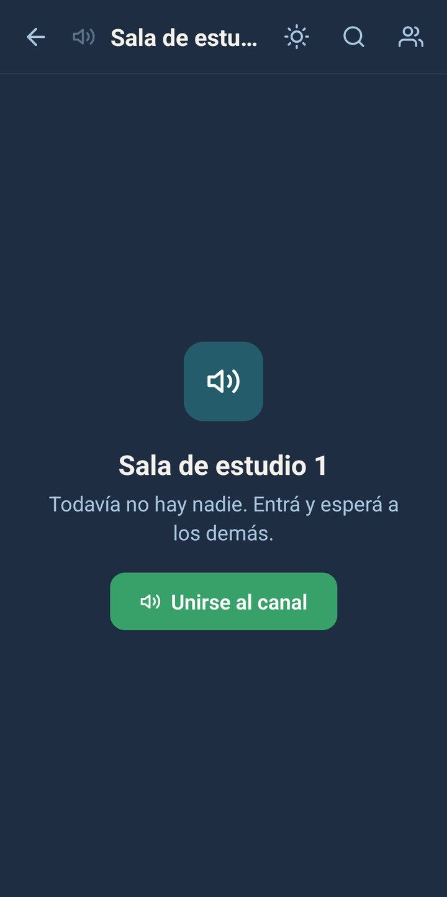</td>
    <td>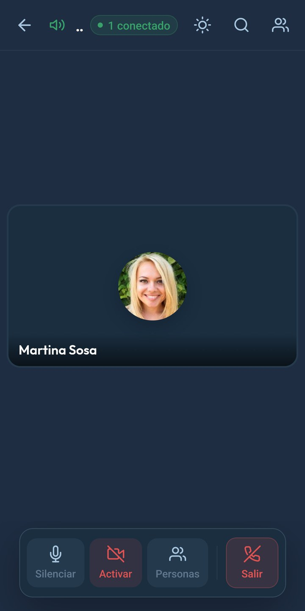</td>
  </tr>
</table>

Los canales con el ícono del parlante son de voz: sirven para hablar en vivo, prender la cámara o mostrar tu pantalla.

### Entrar a un canal de voz

1. En la lista de canales del servidor, tocá un canal con el ícono del parlante. Vas a ver quién está adentro, o el aviso de que todavía no hay nadie.
2. Tocá **Unirse al canal**.
3. La primera vez, el celular te pide permiso para usar el micrófono. Aceptalo: sin ese permiso no te escuchan.
4. Cuando arriba dice **conectado**, ya estás en la llamada. Cada persona aparece en un recuadro con su foto, que se ilumina cuando habla.

### Durante la llamada

Los botones de abajo sirven para:

- **Silenciar**: apaga tu micrófono, pero seguís escuchando a los demás. Tocalo de nuevo para volver a hablar.
- **Activar**: prende tu cámara. Tu video reemplaza tu foto en el recuadro.
- **Personas**: abre la lista de quienes están en el canal.
- **Salir**: corta y te saca del canal.

También podés silenciar el micrófono o dejar de escuchar el audio (el botón de los auriculares) desde la barra de abajo de la pantalla principal, sin entrar al canal.

Podés salir de la pantalla del canal con la flecha de arriba y seguir en la llamada mientras chateás en otro lado.

### Compartir pantalla

Esta opción está solo en el APK de Android, no en Expo Go.

<!-- Captura de compartir pantalla (desde el APK) -->

1. Entrá a un canal de voz.
2. En la barra de abajo, tocá **Pantalla**.
3. Android te pregunta si querés compartir toda la pantalla o una sola app. Elegí y confirmá.
4. El botón pasa a decir **Compartiendo** y los demás ven tu pantalla en un recuadro aparte. Para dejar de compartir, tocalo otra vez.

Mientras compartís, todo lo que aparezca en la pantalla lo ven los demás, también las notificaciones. Si vas a mostrar algo privado, poné el celular en **No molestar** antes.

## 8. Miembros y perfiles

<table>
  <tr>
    <td>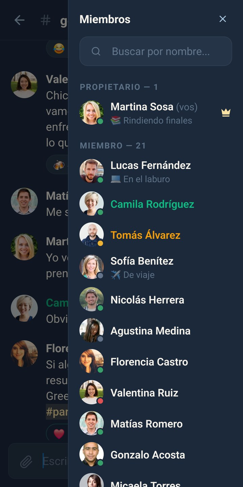</td>
    <td>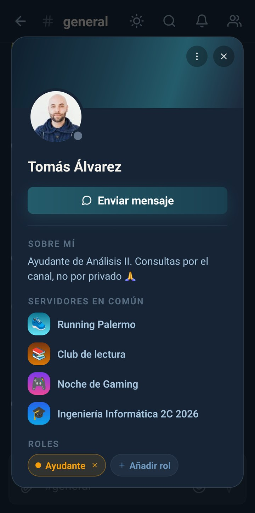</td>
  </tr>
</table>

El ícono de las dos personas, arriba a la derecha en un canal, abre la lista de miembros. Arriba aparece el dueño del servidor y después el resto. El puntito de la foto indica el estado de cada uno: verde si está en línea, amarillo si está ausente, rojo si no quiere que lo molesten y gris si está desconectado.

Tocá a alguien para ver su perfil: su descripción, los servidores que tienen en común y sus roles en este servidor. Desde ahí podés mandarle un mensaje directo. En el menú **⋮** están las opciones para reportarlo o bloquearlo.

## 9. Tu perfil

<table>
  <tr>
    <td>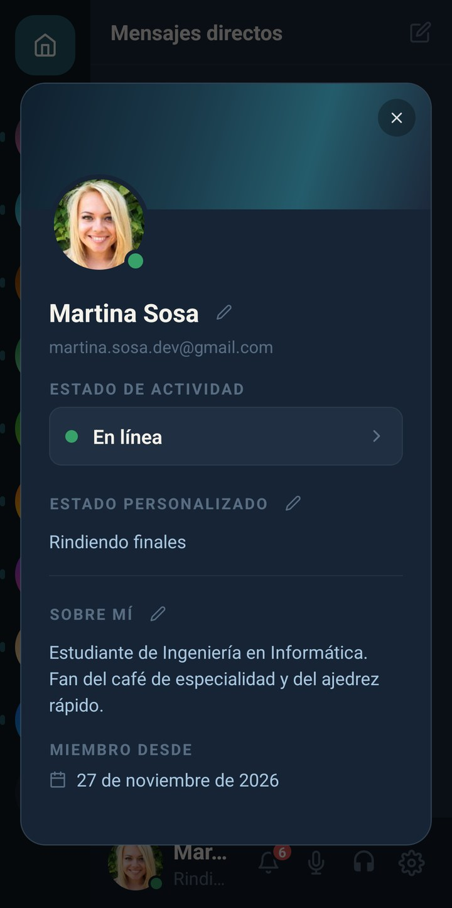</td>
    <td>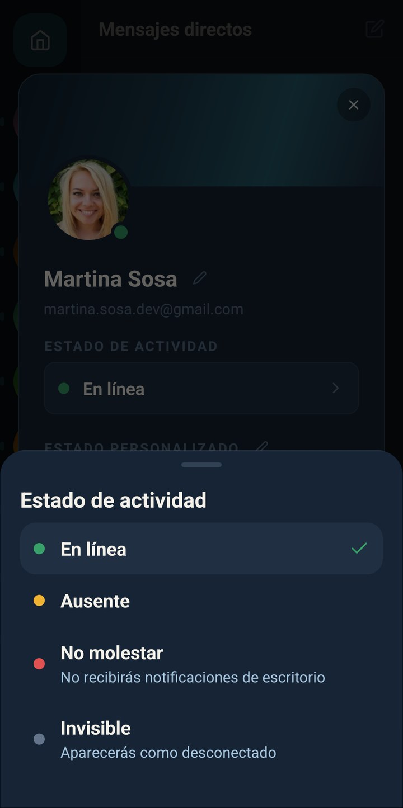</td>
  </tr>
</table>

Tocá tu foto en la barra de abajo para ver tu perfil. Con los lápices cambiás tu nombre, tu foto, la descripción ("Sobre mí") y el estado personalizado, que es esa frase corta con un emoji que ven los demás debajo de tu nombre ("Rindiendo finales", "De viaje").

En **Estado de actividad** elegís cómo te ven los demás:

- **En línea**: estás disponible.
- **Ausente**: te fuiste un rato. La app lo pone sola si no la usás por un tiempo.
- **No molestar**: no te llegan avisos.
- **Invisible**: usás la app normal, pero los demás te ven desconectado.

## 10. Notificaciones

<table>
  <tr>
    <td>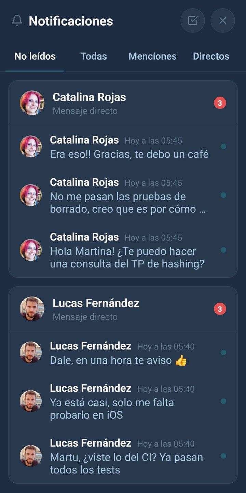</td>
    <td>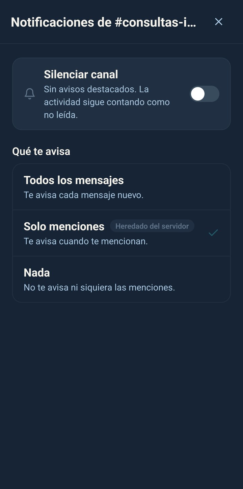</td>
  </tr>
</table>

**La campanita** de la barra de abajo junta todo lo que te perdiste: mensajes directos, menciones y avisos. Las pestañas filtran entre **No leídos**, **Todas**, **Menciones** y **Directos**. Con el botón de arriba marcás todo como leído.

**Ajustar qué te avisa.** Cada servidor y cada canal tiene su propia configuración: desde el menú del servidor (**Notificaciones**) o desde los tres puntos de un canal. Podés elegir que te avise **Todos los mensajes**, **Solo menciones** o **Nada**, o silenciarlo del todo. Si un canal no tiene una configuración propia, usa la del servidor; eso es lo que significa la etiqueta "Heredado del servidor".

**Notificaciones push.** En el APK, cuando no tenés la app abierta, te llegan al celular las menciones y los mensajes directos. Las prendés o apagás desde **Configuración → Notificaciones**.

## 11. Administrar un servidor

Esta parte es para el dueño del servidor y para quienes tengan un rol con los permisos necesarios. Si no ves alguna de estas opciones, es porque tu rol no las tiene.

### Canales y categorías

<table>
  <tr>
    <td>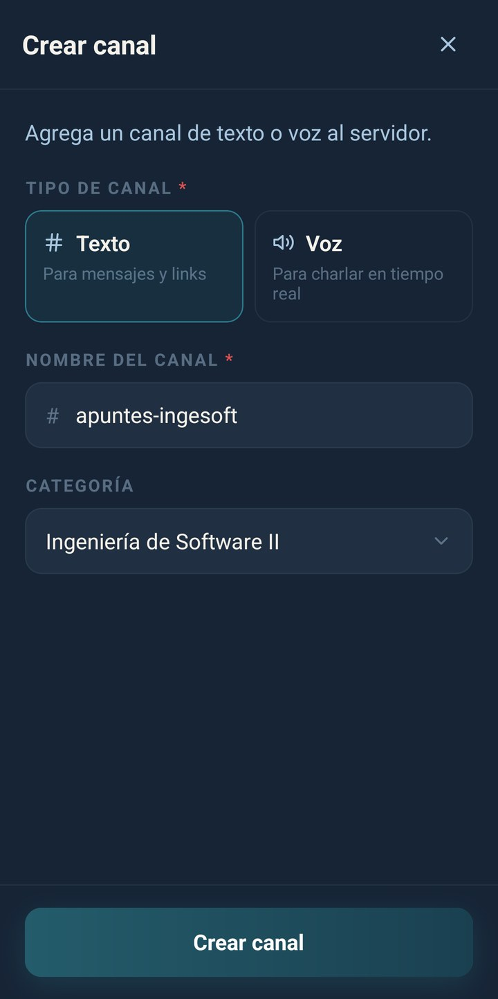</td>
    <td>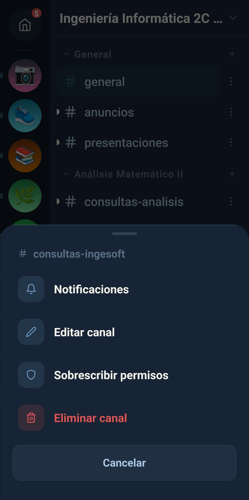</td>
  </tr>
</table>

El **+** al lado del nombre de una categoría crea un canal adentro de ella. Elegís si es de texto o de voz, le ponés nombre y listo. Las categorías nuevas se crean desde el menú del servidor.

Los tres puntos al lado de cada canal permiten cambiarle el nombre o el tema, ajustar sus permisos para cada rol (por ejemplo, un canal de anuncios donde solo escriben los ayudantes) o eliminarlo. Para cambiar el orden, mantené apretado un canal y arrastralo.

### Configuración del servidor

<table>
  <tr>
    <td>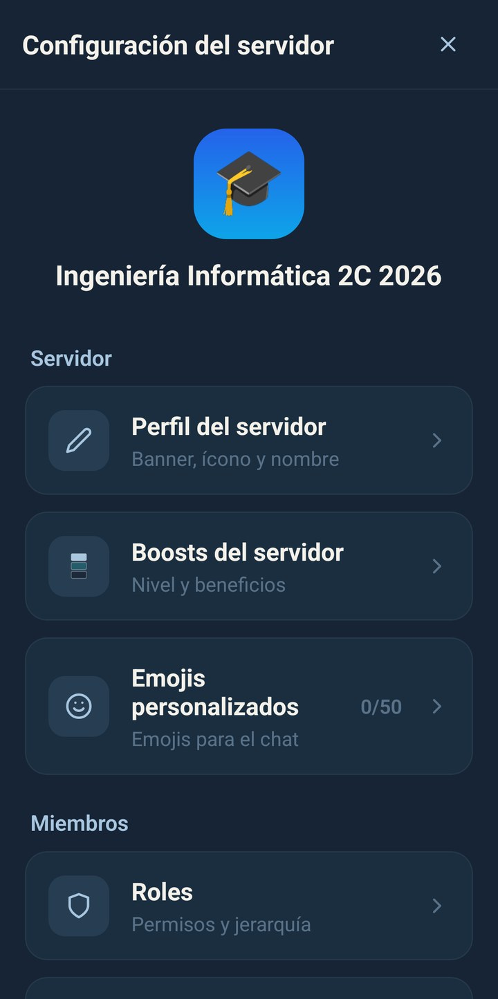</td>
    <td>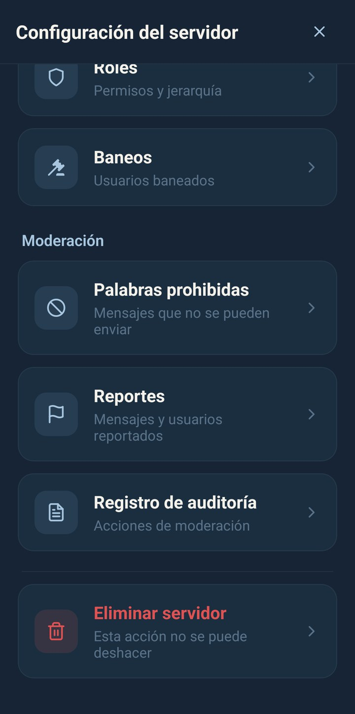</td>
  </tr>
</table>

Desde el menú del servidor, en **Configuración del servidor**, están:

- **Perfil del servidor**: nombre, ícono y banner.
- **Boosts del servidor**: el nivel actual y lo que se desbloquea con cada nivel.
- **Emojis personalizados**: subí los emojis propios de tu comunidad.
- **Roles** y **Baneos**: ver más abajo.
- **Palabras prohibidas**: una lista de palabras que no se pueden mandar en el servidor.
- **Reportes**: los mensajes y usuarios que reportaron los miembros, para revisarlos y cerrarlos.
- **Registro de auditoría**: quién hizo cada acción de moderación y cuándo.
- **Eliminar servidor**: lo borra para todos. Te pide escribir el nombre del servidor para confirmar, porque no se puede deshacer.

### Roles y permisos

<table>
  <tr>
    <td>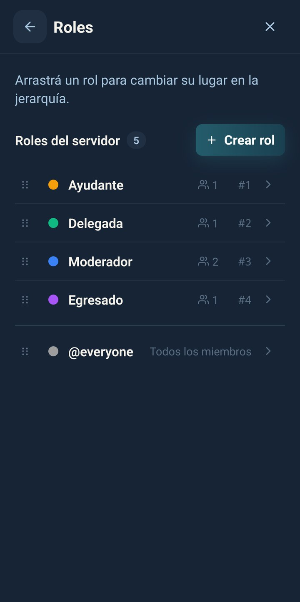</td>
    <td>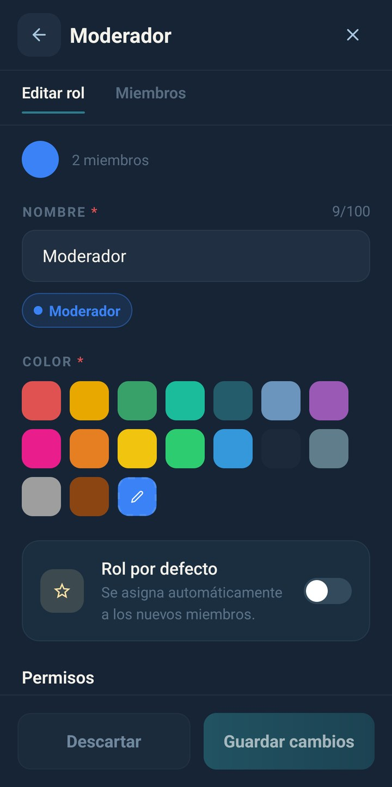</td>
    <td>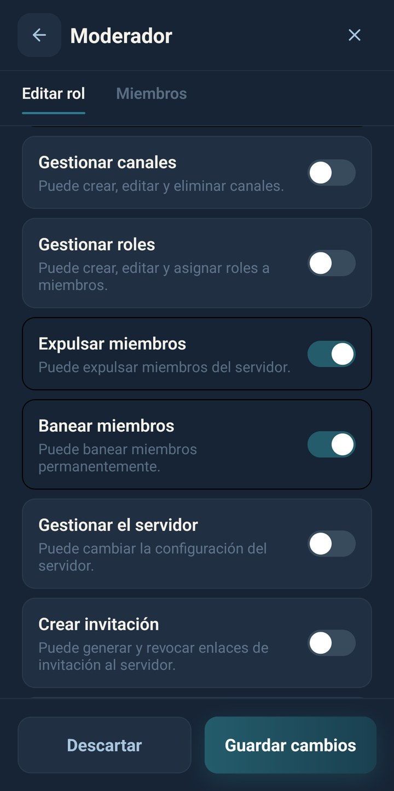</td>
  </tr>
</table>

Los roles agrupan permisos. En un servidor de la facultad, por ejemplo, podés tener "Ayudante", "Delegada" y "Moderador", cada uno con lo que necesita hacer.

En **Roles** ves la lista con la cantidad de miembros de cada rol. El orden importa: un rol más arriba tiene más jerarquía que los de abajo; para cambiarlo, arrastrá el rol. **@everyone** es el rol que tienen todos y define lo que puede hacer cualquier miembro.

Al tocar un rol podés cambiarle el nombre y el color (el nombre de quienes lo tienen se ve de ese color en el chat), marcarlo como **Rol por defecto** para que se asigne solo a cada miembro nuevo, y prender o apagar cada permiso. No te olvides de tocar **Guardar cambios**. En la pestaña **Miembros** ves quiénes lo tienen.

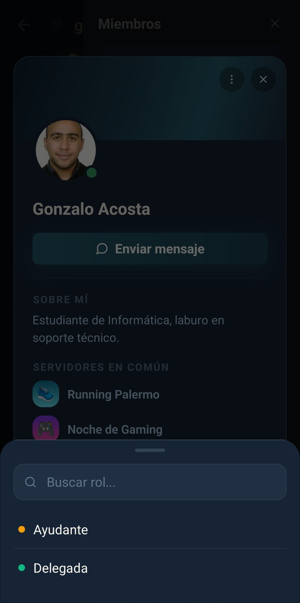

Para darle un rol a alguien, abrí su perfil desde la lista de miembros, tocá **Añadir rol** y elegilo. Para sacárselo, tocá la cruz al lado del rol.

### Moderar miembros

<table>
  <tr>
    <td>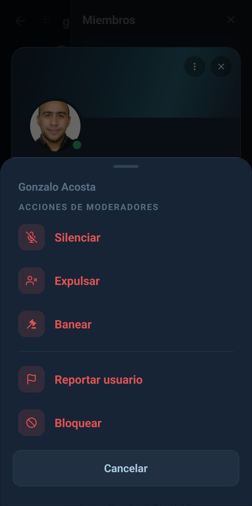</td>
    <td>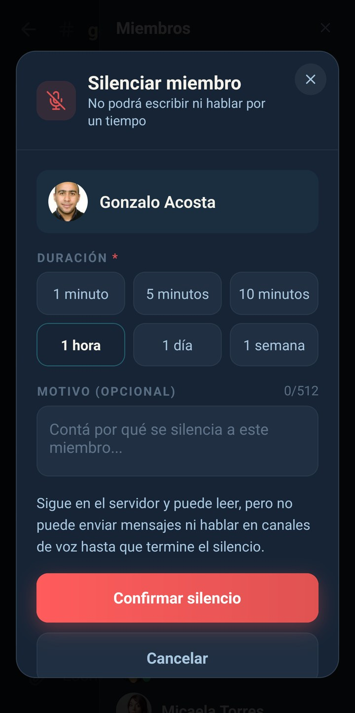</td>
  </tr>
</table>

En el perfil de un miembro, el menú **⋮** muestra las acciones de moderación que tu rol tiene habilitadas:

- **Silenciar**: la persona sigue en el servidor y puede leer, pero no puede escribir ni hablar en los canales de voz durante el tiempo que elijas (desde 1 minuto hasta 1 semana).
- **Expulsar**: la saca del servidor. Puede volver a entrar si consigue otra invitación.
- **Banear**: la saca y no la deja volver. Los baneos se revisan y se levantan desde **Configuración del servidor → Baneos**.

En los tres casos podés escribir un motivo. Todo queda en el registro de auditoría.

## 12. Configuración de tu cuenta

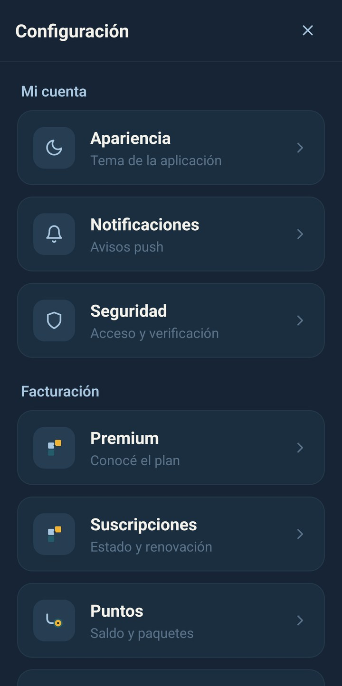

El engranaje de la barra de abajo abre la configuración de tu cuenta.

### Seguridad

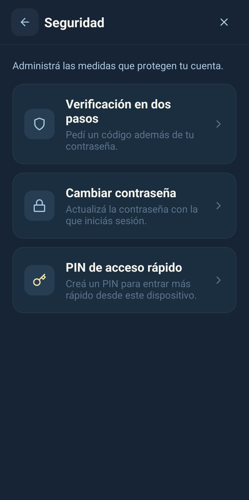

En **Configuración → Seguridad** están las tres formas de proteger tu cuenta.

#### Verificación en dos pasos

Con esto, además de la contraseña, para entrar hace falta un código que genera una app en tu celular. Aunque alguien sepa tu contraseña, sin ese código no puede entrar.

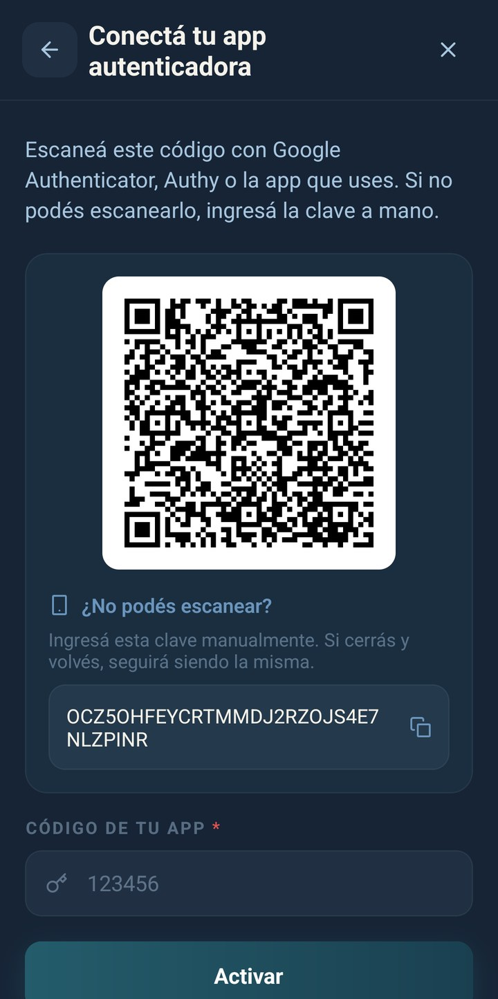

1. Instalá una app autenticadora en tu celular, como Google Authenticator o Authy.
2. En Discordia, entrá a **Configuración → Seguridad → Verificación en dos pasos** y empezá la activación.
3. La app te muestra un código QR. Escanealo con la app autenticadora. Si no podés, tocá **¿No podés escanear?** y copiá la clave a mano.
4. La app autenticadora empieza a mostrar un código de seis números que cambia cada 30 segundos. Escribilo en **Código de tu app** y tocá **Activar**.
5. Discordia te muestra tus **códigos de recuperación**. Guardalos en un lugar seguro, fuera del celular: si lo perdés, son la única forma de entrar.

Desde la misma pantalla podés generar códigos de recuperación nuevos o desactivar la verificación en dos pasos.

#### Cambiar la contraseña

1. Entrá a **Configuración → Seguridad → Cambiar contraseña**.
2. Escribí tu contraseña actual y la nueva dos veces.
3. Guardá los cambios.

Si entraste siempre con Google y nunca tuviste contraseña, desde ahí mismo podés crear una.

#### PIN de acceso rápido

<table>
  <tr>
    <td>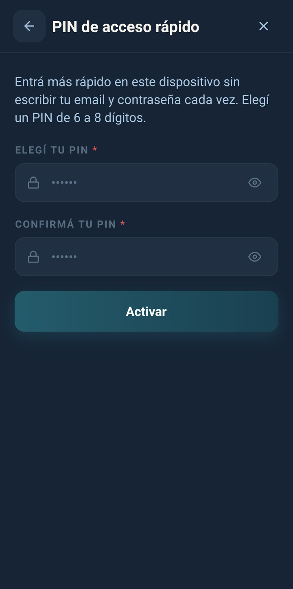</td>
    <td>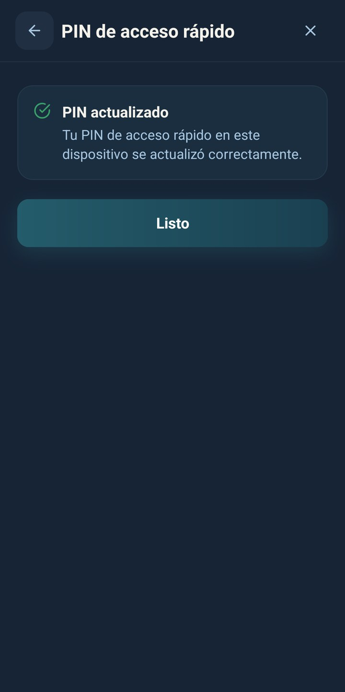</td>
  </tr>
</table>

1. Entrá a **Configuración → Seguridad → PIN de acceso rápido**.
2. Elegí un PIN de 6 a 8 números y escribilo dos veces.
3. Tocá **Activar**. Vas a ver el aviso **PIN actualizado**; tocá **Listo**.

Desde ese momento, cuando cierres sesión en este celular, vas a poder [entrar con el PIN](#entrar-con-pin). Para cambiarlo, repetí los pasos con un PIN nuevo.

### Apariencia

<table>
  <tr>
    <td></td>
    <td></td>
  </tr>
</table>

Elegís entre el **modo oscuro** y el **modo claro**. El cambio se aplica en toda la app al instante.

## 13. Premium, puntos y boosts

Hay dos cosas que se pagan, y conviene no confundirlas:

- **Premium** es una suscripción mensual para tu cuenta. Los beneficios son tuyos y te siguen a cualquier servidor.
- **Los puntos** se compran por paquete y se usan para **boostear** servidores. Los beneficios de un boost son para todos los miembros de ese servidor.

Los pagos se hacen en Mercado Pago. Discordia no guarda los datos de tu tarjeta.

### Suscribirte a Premium

<table>
  <tr>
    <td></td>
    <td></td>
  </tr>
</table>

1. Entrá a **Configuración → Premium**.
2. Tocá **Suscribirse**. Se abre Mercado Pago con el pago mensual ($ 4.999).
3. Completá el pago en Mercado Pago y volvé a la app.
4. La app verifica el pago y, cuando se aprueba, el plan pasa a decir **Activo hasta** con la fecha del próximo vencimiento.

### Qué te da Premium

- **Adjuntos de hasta 50 MB** por archivo, en canales y en mensajes directos (sin Premium, el límite es 10 MB).
- **Emojis animados**: podés usar emojis GIF en tus mensajes y reacciones.
- **Emojis de todos tus servidores**: en el selector de emojis, la pestaña **Del servidor** te muestra los emojis propios de todos los servidores de los que sos miembro, no solo los del servidor donde estás escribiendo.
- **Insignia Premium**: aparece al lado de tu nombre en tu perfil, para vos y para los demás.

### Ver o cancelar la suscripción

En **Configuración → Suscripciones** ves si Premium está activo y cuándo se renueva. Se renueva solo cada mes.

Para cancelar, tocá **Cancelar renovación**. No perdés nada en el momento: los beneficios siguen hasta la fecha que ya pagaste y después no se vuelve a cobrar.

### Comprar puntos

1. Entrá a **Configuración → Puntos**. Arriba ves tu **saldo actual**.
2. Elegí uno de los paquetes, por ejemplo 100 puntos por $ 1.000 o 550 por $ 5.000.
3. Completá el pago en Mercado Pago. Cuando se aprueba, los puntos se suman a tu saldo.

En **Configuración → Historial** quedan todos tus pagos y movimientos de puntos.

### Boostear un servidor

Cada boost cuesta 100 puntos, no vence y suma una unidad al servidor. Cuando el servidor junta suficientes boosts, sube de nivel y todos sus miembros reciben los beneficios:

| Nivel | Boosts | Qué desbloquea |
|---|---|---|
| 1 | 5 | más emojis personalizados e ícono animado |
| 2 | 15 | banner del servidor y adjuntos de hasta 25 MB para todos |
| 3 | 30 | link de invitación propio, que no vence, e insignia de Servidor Boosteado |

<table>
  <tr>
    <td></td>
    <td></td>
  </tr>
  <tr>
    <td></td>
    <td></td>
  </tr>
</table>

1. Entrá al servidor, tocá su nombre arriba de todo y elegí **Boosts**.
2. Vas a ver el nivel actual y cuántos boosts faltan para el siguiente.
3. Tocá **Boostear por 100 puntos**.
4. La app te muestra cuánto te queda de saldo después del boost. Si con ese boost el servidor sube de nivel, también te avisa. Tocá **Confirmar boost**.
5. Aparece **Boost aplicado** con el total de boosts del servidor. Tocá **Listo**.

Si no te alcanzan los puntos, desde la misma pantalla podés ir a comprar más. En la pestaña **Beneficios** ves todo lo que desbloquea cada nivel.

## 14. Problemas comunes

**No me llega el mail de confirmación.** Revisá spam y promociones, y fijate que el correo esté bien escrito. Si el enlace te llegó pero ya venció, al abrirlo la app te ofrece **Reenviar confirmación**.

**La app dice que no tengo permisos para algo.** Las acciones de administración dependen de tu rol en ese servidor. Pedile al dueño o a un administrador que te dé el permiso.

**No puedo entrar a un canal de voz.** Fijate que la app tenga permiso para usar el micrófono, en los ajustes del celular. Si dice que la voz no está disponible, esperá unos minutos y probá de nuevo.

**No me llegan notificaciones push.** Solo funcionan en el APK, no en Expo Go. Revisá que estén prendidas en **Configuración → Notificaciones**, que el celular no tenga bloqueadas las notificaciones de la app y que no estés en **No molestar**.

**Me sacaron de un servidor.** Si te expulsaron, podés volver con una invitación nueva. Si te banearon, no vas a poder entrar hasta que un moderador levante el baneo.
