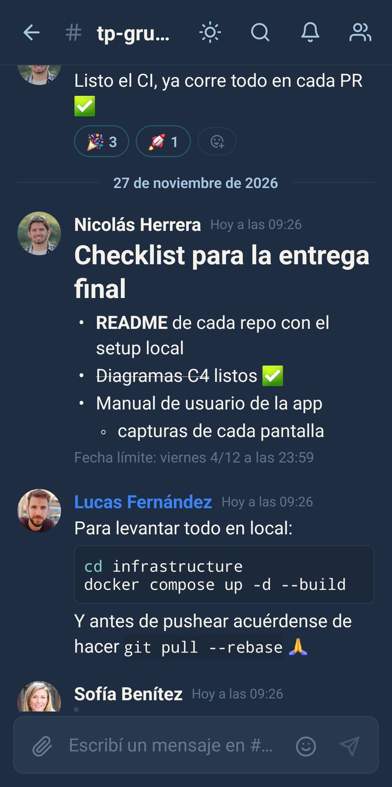
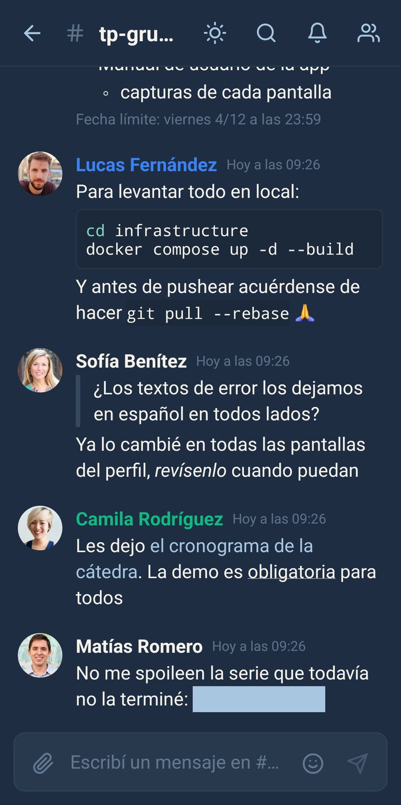
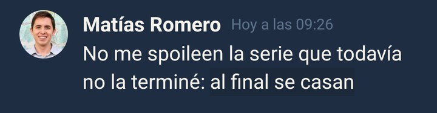

# Formato de mensajes

Los mensajes se pueden escribir con formato usando símbolos simples, al estilo Markdown. Escribís los símbolos como texto común y, cuando mandás el mensaje, se ve con el formato aplicado. Funciona igual en los canales de un servidor y en los mensajes directos, y también en la web.

En la app, mientras escribís, el cuadro de texto muestra los símbolos tal cual. El formato aparece cuando el mensaje se publica.

[Volver a la guía de usuario](README.md)

<table>
  <tr>
    <td></td>
    <td></td>
  </tr>
</table>

## Contenido

- [Texto](#texto)
- [Spoilers](#spoilers)
- [Links](#links)
- [Títulos y texto chico](#títulos-y-texto-chico)
- [Listas](#listas)
- [Citas](#citas)
- [Código](#código)
- [Escribir los símbolos sin formato](#escribir-los-símbolos-sin-formato)
- [Menciones dentro del formato](#menciones-dentro-del-formato)
- [Qué no se puede hacer](#qué-no-se-puede-hacer)

## Texto

| Escribís | Se ve como |
|---|---|
| `**negrita**` | **negrita** |
| `*cursiva*` o `_cursiva_` | _cursiva_ |
| `***negrita y cursiva***` | **_negrita y cursiva_** |
| `__subrayado__` | <u>subrayado</u> |
| `___subrayado y cursiva___` | <u>_subrayado y cursiva_</u> |
| `~~tachado~~` | ~~tachado~~ |
| `\|\|spoiler\|\|` | tapado hasta que lo tocás |
| `` `código` `` | `código` |

Se pueden combinar:

```
**Importante: *leer antes del viernes***
~~reunión a las 15~~ **reunión a las 16**
```

Los símbolos tienen que ir pegados al texto: `**hola**` sale en negrita, pero `** hola **` queda tal cual. Si falta el símbolo de cierre, también se ve como texto común.

El guion bajo solo marca formato al principio o al final de una palabra, así que algo como `mi_archivo_final` se ve como lo escribiste.

## Spoilers

Lo que va entre dos barras verticales dobles se muestra tapado hasta que alguien lo toca:

```
El final es que ||el mayordomo era inocente||.
```



Cada spoiler se destapa por separado y solo para quien lo tocó. En la lista de mensajes directos, donde se ve el último mensaje de cada conversación, el spoiler aparece como `(spoiler)` para no arruinarle la sorpresa a nadie.

## Links

Una dirección que empieza con `http://` o `https://` se convierte en link sola:

```
Los apuntes están en https://ejemplo.com/apuntes
```

Para mostrar otro texto en lugar de la dirección, escribí el texto entre corchetes y la dirección entre paréntesis, pegados:

```
Les dejo [el cronograma de la cátedra](https://ejemplo.com/cronograma).
```

Al tocar un link, se abre en el navegador del celular. Las direcciones sin `http://` o `https://` (por ejemplo, `ejemplo.com`) quedan como texto común.

## Títulos y texto chico

| Escribís | Se ve como |
|---|---|
| `# Título grande` | título del tamaño más grande |
| `## Título mediano` | título mediano |
| `### Título chico` | título chico |
| `-# Texto chico` | texto chico y gris |

El numeral va al principio del renglón y seguido de un espacio. Sin el espacio no es un título: `#general` sigue siendo un link al canal.

El texto chico sirve para aclaraciones o notas al pie:

```
Mañana no hay reunión.
-# Se pasa al jueves a la misma hora.
```

## Listas

| Escribís | Se ve como |
|---|---|
| `- item` o `* item` | viñeta |
| `1. item` | lista numerada |
| `  - subitem` (con dos espacios adelante) | viñeta adentro de otra |

```
Para mañana:
- comprar pan
- llamar a **Juli**
  - antes de las 18
- revisar el `README`
```

Las listas numeradas empiezan en el número del primer renglón y siguen de a uno, aunque escribas otros números en los renglones de abajo.

## Citas

| Escribís | Se ve como |
|---|---|
| `> texto` | ese renglón citado |
| `>>> texto` | ese renglón y todo lo que sigue, citado |

Varios renglones seguidos que empiezan con `>` forman una sola cita:

```
> No hay que apurarse,
> hay que llegar.
```

Para citar un texto largo sin poner `>` en cada renglón, empezá con `>>>` y un espacio: todo lo que sigue hasta el final del mensaje queda dentro de la cita.

## Código

Para una palabra o un comando corto dentro de una oración, encerralo entre backticks: `` `git pull` ``.

Para varias líneas, usá un bloque de código: tres backticks en un renglón, el código, y tres backticks al final. Después de los primeros tres podés poner el lenguaje para que se coloree:

````
```python
def saludar(nombre):
    return f"Hola, {nombre}"
```
````

Se colorean JavaScript, TypeScript, Python, Java, C, C++, C#, SQL, Bash, JSON, HTML, XML, CSS, Go, Rust y Kotlin. Para el nombre del lenguaje se aceptan las abreviaturas comunes (`js`, `ts`, `py`, `sh`) y no importan las mayúsculas. Si no ponés el lenguaje o no está en la lista, el código se ve de un solo color.

Dentro del código no se aplica ningún formato: los asteriscos, los numerales y las menciones se ven tal cual los escribiste.

## Escribir los símbolos sin formato

Si querés que un símbolo se vea tal cual, poné una barra invertida `\` adelante:

| Escribís | Se ve como |
|---|---|
| `\*no es cursiva\*` | \*no es cursiva\* |
| `2 \* 3 \* 4` | 2 \* 3 \* 4 |
| `\# no es título` | \# no es título |
| `1\. no es lista` | 1. no es lista |

Una barra delante de cualquier otro carácter queda como está, así que algo como `C:\Usuarios` no cambia.

## Menciones dentro del formato

Las menciones a personas, roles, `@everyone` y canales funcionan dentro de cualquier formato. Por ejemplo, `**Atención @everyone**` se ve en negrita con la mención resaltada.

La excepción es el código: si mencionás a alguien adentro de `` `...` `` o de un bloque de código, se manda como texto y esa persona no recibe aviso.

## Qué no se puede hacer

Esto no tiene formato y se ve como texto común:

- títulos de cuatro numerales o más (`####`);
- imágenes y tablas;
- colores para lenguajes que no están en la lista de [Código](#código).

En el centro de notificaciones de la app y en las notificaciones push, el mensaje se muestra con los símbolos tal cual se escribieron.
